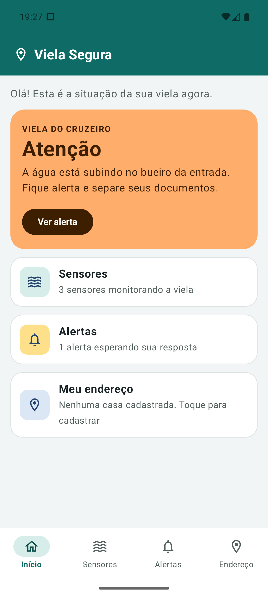
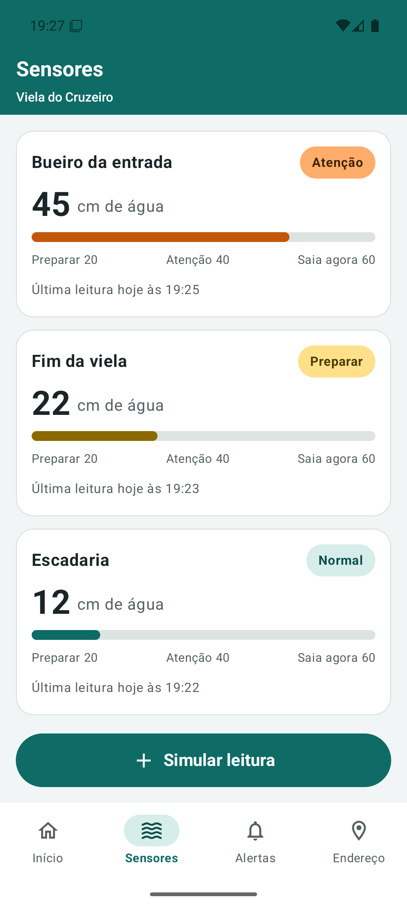
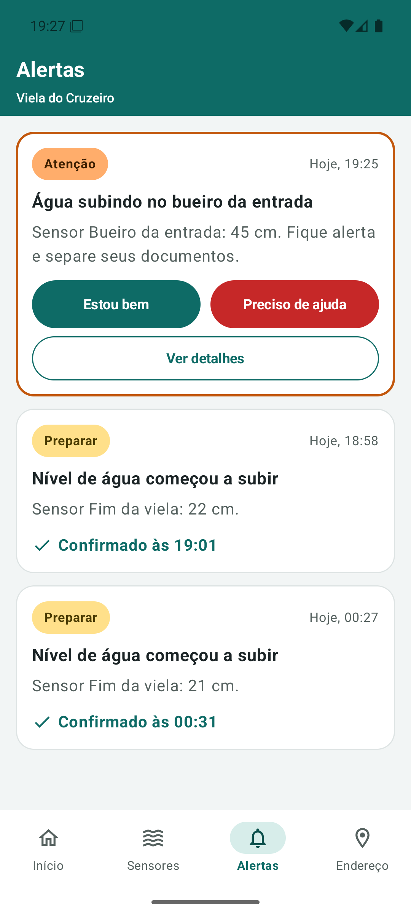
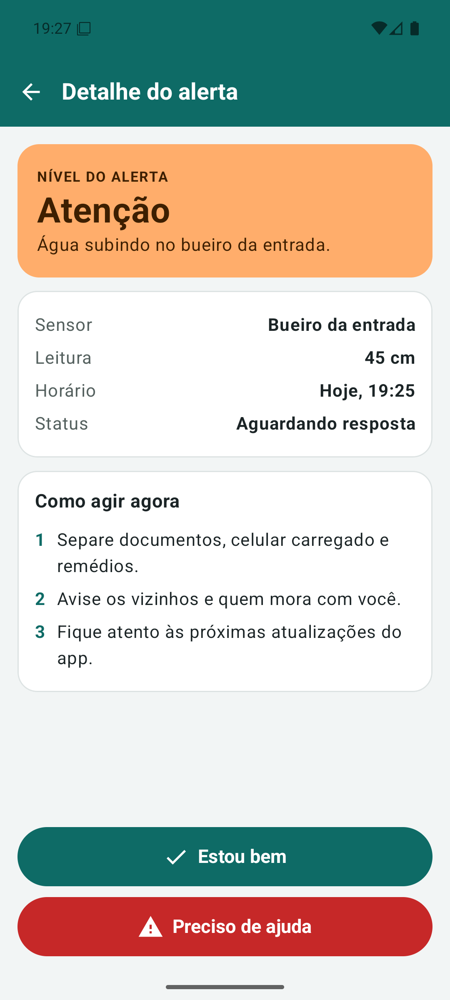
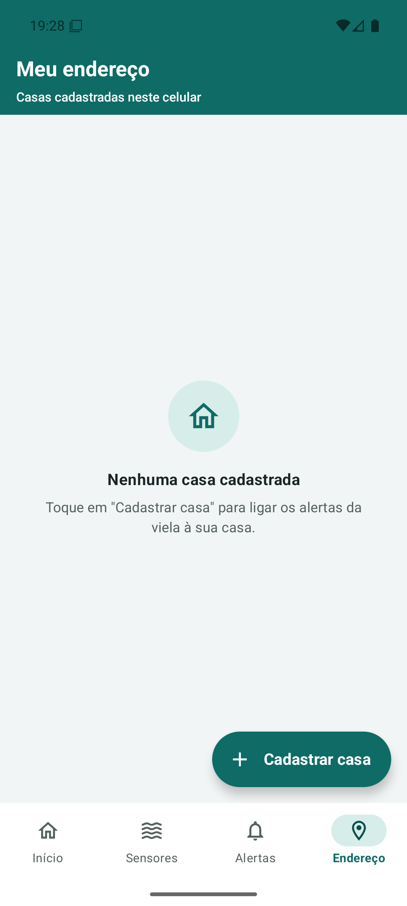
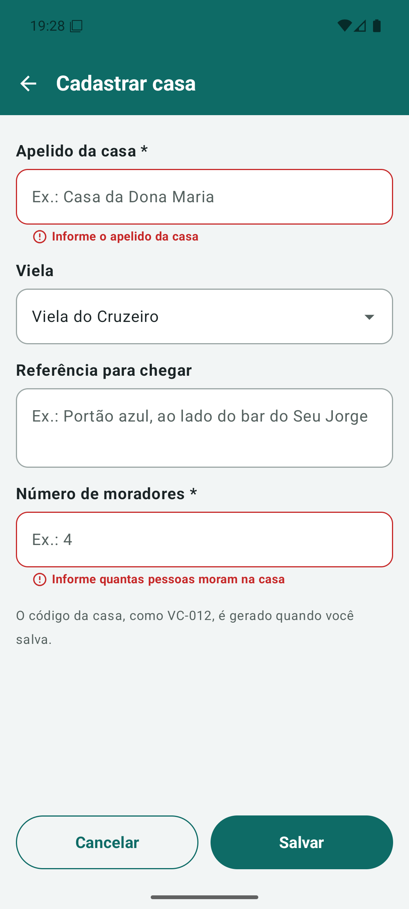
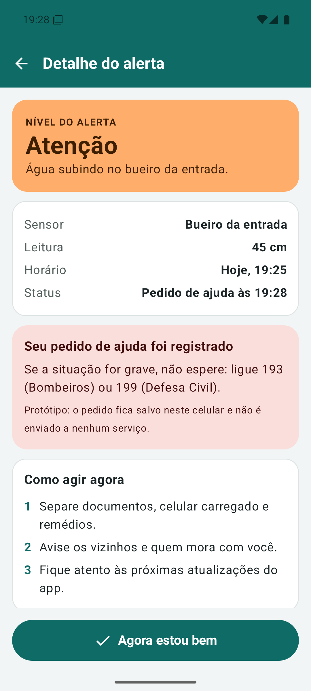
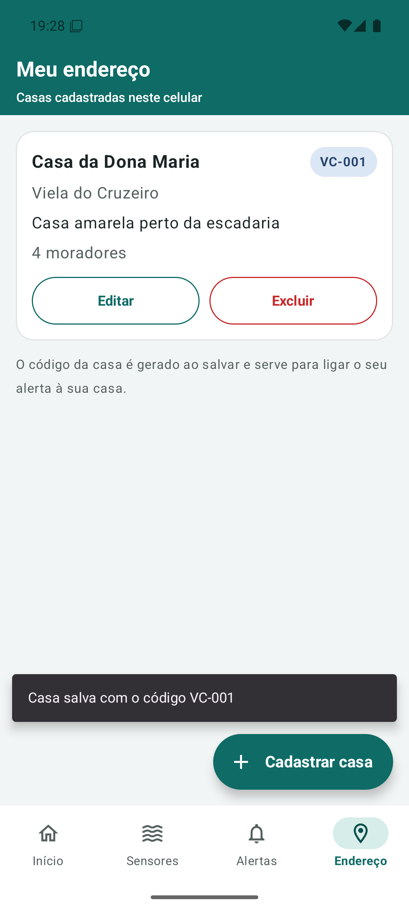
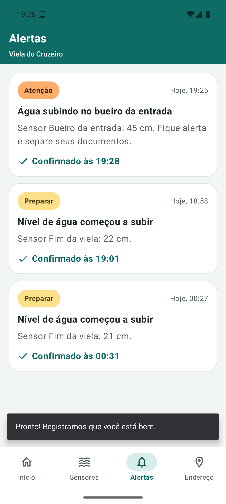
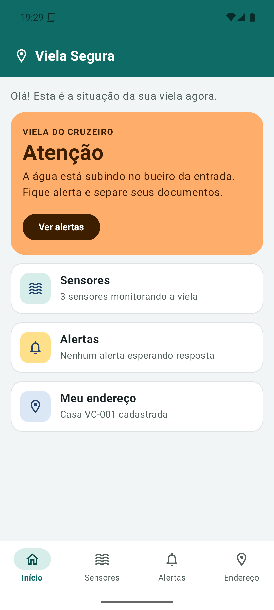

# Viela Segura

Aplicativo Android de **alerta de alagamento para moradores de vielas** em comunidades urbanas. O app mostra o nível da água medido por sensores instalados na viela, avisa quando a água sobe e permite que cada família cadastre sua casa e confirme que está bem durante um alerta.

> Protótipo acadêmico (Desafio CitizenTech). Os sensores e as leituras são **simulados** dentro do próprio app. Não há integração real com sensores, Defesa Civil ou qualquer serviço público.

## Equipe Sentinela

| Nome completo | RM |
|---|---|
| Rodrigo Henrique de Amorim Sena | RM 555325 |
| Gustavo Bifon de Alcantara | RM 554588 |
| Ruy Fichman Accioly | RM 558183 |

---

## 1. Contextualização

### Problema
Em muitas comunidades, as vielas são estreitas, ficam em áreas baixas e têm drenagem precária. Em chuvas fortes, a água sobe muito rápido pelos bueiros e escadarias, e os moradores muitas vezes só percebem quando ela já está entrando nas casas. Sem aviso antecipado, as famílias perdem documentos, remédios e móveis, e pessoas idosas, crianças e pessoas com deficiência correm risco de vida. Além disso, lideranças comunitárias e vizinhos não têm como saber rapidamente quem já está seguro.

### Proposta
O **Viela Segura** reúne em um só lugar:
- o **nível da água** em pontos críticos da viela (bueiro, fim da viela, escadaria), com faixas de risco claras: *Normal*, *Preparar* (20 cm), *Atenção* (40 cm) e *Saia agora* (60 cm);
- **alertas** automáticos quando o nível de risco sobe, com orientações simples de "como agir agora";
- os botões **"Estou bem"**, para o morador confirmar que está seguro, e **"Preciso de ajuda"**, para registrar que precisa de socorro;
- o **cadastro da casa** (apelido, viela, ponto de referência e número de moradores), que gera um código (ex.: `VC-012`) para ligar a família aos alertas da sua viela.

### Público beneficiado
Moradores de vielas e áreas de risco de alagamento em comunidades urbanas, principalmente famílias com idosos, crianças ou pessoas com mobilidade reduzida. A linguagem é simples, os textos são grandes e as cores seguem a lógica de semáforo para facilitar o uso por pessoas com pouca familiaridade com tecnologia.

### ODS relacionados

| ODS | Meta | Conexão com o app |
|---|---|---|
| **ODS 11 – Cidades e Comunidades Sustentáveis** | 11.5: reduzir o número de mortes e de pessoas afetadas por catástrofes, incluindo as relacionadas à água, com foco nas pessoas em situação de vulnerabilidade | O app avisa os moradores de vielas (população vulnerável) quando a água sobe, dando tempo para proteger documentos, remédios e sair de casa antes do alagamento. |
| **ODS 13 – Ação Contra a Mudança Global do Clima** | 13.1: reforçar a resiliência e a capacidade de adaptação a riscos relacionados ao clima e às catástrofes naturais | Chuvas extremas estão mais frequentes. O app ajuda a comunidade a se preparar (níveis "Preparar" e "Atenção") e a reagir de forma organizada ("Saia agora" + respostas "Estou bem" e "Preciso de ajuda"). |

---

## 2. Funcionalidades

| Tela | O que faz |
|---|---|
| **Início** | Cartão com a situação atual da viela (cor e texto mudam conforme o nível de risco do sensor mais crítico) e atalhos para Sensores, Alertas e Meu endereço, com contadores atualizados em tempo real. |
| **Sensores** | Lista (`LazyColumn`) dos sensores com altura da água, etiqueta de nível, barra de progresso e horário da última leitura. Botão **Simular leitura** gera uma nova medição; se o risco subir, um alerta é criado automaticamente. |
| **Alertas** | Lista de alertas, do mais recente para o mais antigo. Alertas sem resposta ficam destacados e têm os botões **Estou bem**, **Preciso de ajuda** e **Ver detalhes**. Depois da resposta, o cartão mostra "Confirmado às HH:mm" ou, em vermelho, "Pedido de ajuda às HH:mm" com o botão **Agora estou bem**. |
| **Detalhe do alerta** | Nível, sensor, leitura, horário, status e o passo a passo "Como agir agora" para aquele nível. Botões **Estou bem** e **Preciso de ajuda** mudam o status do alerta. Após pedir ajuda, aparece um aviso com os telefones 193 (Bombeiros) e 199 (Defesa Civil) e o botão **Agora estou bem**. |
| **Meu endereço** | Lista das casas cadastradas com código gerado, botões **Editar** e **Excluir** (com confirmação e opção **Desfazer**). |
| **Cadastrar / Editar casa** | Formulário com validação: apelido obrigatório (mínimo 3 letras) e número de moradores obrigatório (mínimo 1). Mostra a mensagem de erro abaixo do campo e não salva enquanto houver erro. |

**Retorno ao usuário:** toda ação mostra uma mensagem (Snackbar), por exemplo "Casa salva com o código VC-001", "Pronto! Registramos que você está bem." ou "Bueiro da entrada: 45 cm → 52 cm".
**Estados sem dados:** Alertas, Sensores e Meu endereço exibem ícone e texto explicativo quando a lista está vazia. A tela Início mostra "Nenhuma casa cadastrada. Toque para cadastrar".

### Modelo de dados (Room)

| Entidade | Atributos | Ações do usuário |
|---|---|---|
| `CasaEntity` (tabela `casas`) | `id`, `apelido`, `viela`, `referencia`, `moradores`, `codigo` | cadastrar, visualizar, **editar**, **excluir** |
| `AlertaEntity` (tabela `alertas`) | `id`, `sensorNome`, `titulo`, `descricao`, `leituraCm`, `criadoEm`, `confirmadoEm`, `pediuAjuda` | visualizar, **alterar status** ("Estou bem" / "Preciso de ajuda") |
| `SensorEntity` (tabela `sensores`) | `id`, `nome`, `local`, `viela`, `nivelCm`, `ultimaLeitura` | visualizar, simular leitura |

Todos os registros ficam no banco local `viela_segura.db`. Fechar e abrir o app de novo mantém casas, respostas aos alertas ("Estou bem" e "Preciso de ajuda") e leituras simuladas. O banco está na versão 2, com uma migração (`MIGRACAO_1_2`) que adiciona a coluna `pediuAjuda` sem apagar os dados existentes. Os sensores e três alertas de exemplo são inseridos só na primeira execução (`MonitoramentoRepository.popularDadosIniciais`).

---

## 3. Tecnologias utilizadas

- **Kotlin**
- **Jetpack Compose + Material 3**: `Scaffold`, `TopAppBar`, `NavigationBar`, `Card`, `LazyColumn`, `Column`, `Row`, `OutlinedTextField`, `ExposedDropdownMenuBox`, `Button`, `ExtendedFloatingActionButton`, `AlertDialog`, `Snackbar`
- **Navigation Compose**: 6 destinos, barra inferior com 4 abas e argumentos (`alertaId`, `casaId`)
- **ViewModel + StateFlow** (`lifecycle-viewmodel-compose`, `collectAsStateWithLifecycle`)
- **Room** (`room-runtime`, `room-ktx`, `room-compiler` via **KSP**) com `Flow`, assim a interface se atualiza sozinha quando os dados mudam
- **Coroutines**

---

## 4. Organização do código

```
app/src/main/java/com/ruy/vielasegura/
├── MainActivity.kt              # Ponto de entrada (setContent)
├── VielaSeguraApp.kt            # Application: cria o AppContainer e popula dados simulados
├── AppContainer.kt              # Injeção de dependências manual (banco + repositórios)
├── data/
│   ├── local/
│   │   ├── AppDatabase.kt       # @Database do Room
│   │   ├── dao/                 # CasaDao, SensorDao, AlertaDao
│   │   └── entity/              # CasaEntity, SensorEntity, AlertaEntity
│   └── repository/              # CasaRepository, MonitoramentoRepository
├── model/                       # NivelAgua (faixas de risco), Vielas (lista + geração do código)
├── util/                        # DataFormatter ("Hoje, 14:32")
└── ui/
    ├── AppViewModelProvider.kt  # Fábrica dos ViewModels
    ├── navigation/              # Rotas, NavHost + barra inferior, Mensagens (Snackbar)
    ├── components/              # Componentes reutilizáveis (TopBar, NivelBadge, BarraNivel, EstadoVazio...)
    ├── theme/                   # Cores e tema Material 3
    └── screens/
        ├── inicio/              # InicioScreen + InicioViewModel
        ├── sensores/            # SensoresScreen + SensoresViewModel
        ├── alertas/             # AlertasScreen, AlertaDetalheScreen + ViewModels
        └── casa/                # CasasScreen, CasaFormScreen + ViewModels
```

Fluxo dos dados: **Tela (Compose)** → chama funções do **ViewModel** → **Repository** → **DAO (Room)**. O DAO devolve `Flow`, o ViewModel o expõe como `StateFlow` e a tela o observa com `collectAsStateWithLifecycle()`. Por isso qualquer alteração (salvar, excluir, "Estou bem", "Preciso de ajuda", nova leitura) aparece na hora em todas as telas.

---

## 5. Como executar

1. Instale o **Android Studio** (versão recente, com Android SDK 37 e JDK 17+ incluídos).
2. Abra a pasta do projeto (`File > Open...`) e aguarde a sincronização do Gradle.
3. Crie um emulador em **Device Manager** (ex.: Pixel, Android 14 ou superior) ou conecte um celular com depuração USB ativada. Mínimo: Android 7.0 (API 24).
4. Clique em **Run ▶** (configuração `app`).

Pela linha de comando:
```bash
./gradlew assembleDebug        # gera app/build/outputs/apk/debug/app-debug.apk
./gradlew installDebug         # instala no emulador/dispositivo conectado
```

---

## 6. Fluxo principal e capturas de tela

> As imagens ficam em `docs/screenshots/`. São capturas do app rodando no emulador.

### Fluxo principal
1. O morador abre o app e vê na **Início** a situação da viela ("Atenção – a água está subindo no bueiro da entrada").
2. Em **Sensores**, acompanha o nível de cada ponto e pode tocar em **Simular leitura** para gerar uma nova medição.
3. Em **Alertas**, abre o alerta pendente, lê **Como agir agora** e responde: **Estou bem** (o alerta passa para "Confirmado às HH:mm") ou **Preciso de ajuda** (o alerta fica em vermelho, com "Pedido de ajuda às HH:mm" e os telefones de emergência). Quem pediu ajuda pode tocar depois em **Agora estou bem**.
4. Em **Endereço**, toca em **Cadastrar casa**, preenche o formulário e salva. A casa aparece com o código gerado (ex.: `VC-001`) e pode ser editada ou excluída.
5. Ao fechar e abrir o app, a casa e as confirmações continuam lá (Room).

### Telas

| Início | Sensores | Alertas |
|---|---|---|
|  |  |  |

| Detalhe do alerta | Meu endereço (sem dados) | Cadastrar casa (validação) |
|---|---|---|
|  |  |  |

| Preciso de ajuda |
|---|
|  |

### Evidências pedidas

| 1. Criação de registro | 2. Ação adicional (alterar status do alerta) | 3. Permanência após reabrir |
|---|---|---|
|  |  |  |
| Casa salva aparece na lista com o código gerado e a mensagem "Casa salva com o código VC-001". | Alteração de status: o morador tinha pedido ajuda (print 10) e depois tocou em **Agora estou bem**. O alerta passou para "Confirmado às HH:mm" e apareceu a mensagem "Pronto! Registramos que você está bem." | App fechado (removido dos recentes) e aberto de novo: a casa e o alerta confirmado continuam salvos. |

---

## 7. Onde cada requisito é atendido

| Requisito | Onde |
|---|---|
| Tela inicial com identidade visual e acesso às funcionalidades | `ui/screens/inicio/InicioScreen.kt` |
| Navigation Compose, 3+ telas, ida e volta | `ui/navigation/VielaSeguraNavHost.kt` (6 destinos + barra inferior + botão voltar) |
| Componentes Compose / Material 3 | todas as telas em `ui/screens` e `ui/components/Componentes.kt` |
| Mensagens de ação e estados sem dados | `ui/navigation/Mensagens.kt`, `EstadoVazio` em `Componentes.kt` |
| Entidade com 3+ atributos | `data/local/entity/CasaEntity.kt` (5 atributos + id) |
| Cadastrar e visualizar | `CasaFormScreen.kt` / `CasasScreen.kt` |
| Ação adicional | editar e excluir casa (`CasasScreen.kt`), alterar status do alerta "Estou bem" / "Preciso de ajuda" (`AlertasScreen.kt`, `AlertaDetalheScreen.kt`) |
| Validação de campo obrigatório | `CasaFormViewModel.validar()` |
| Persistência com Room | `data/local/AppDatabase.kt` + DAOs |
| ViewModel e estado | `ui/screens/**/*ViewModel.kt` com `StateFlow` |
